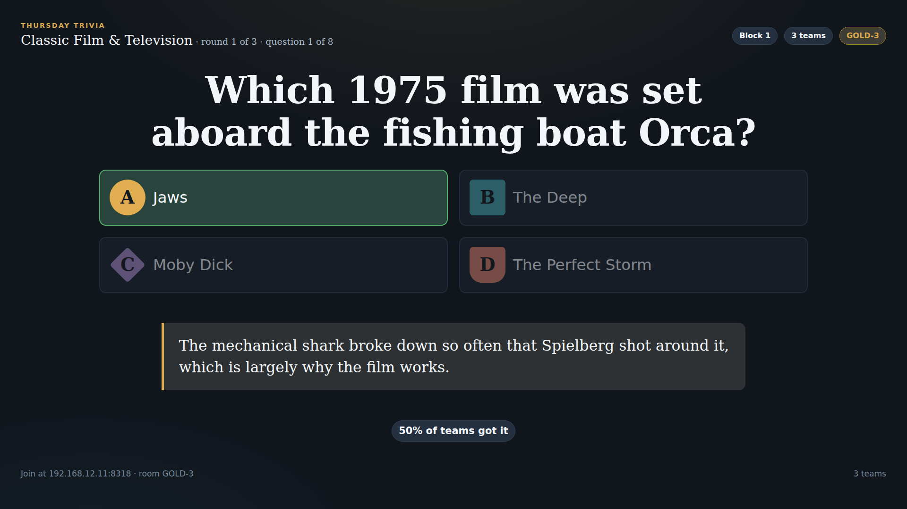
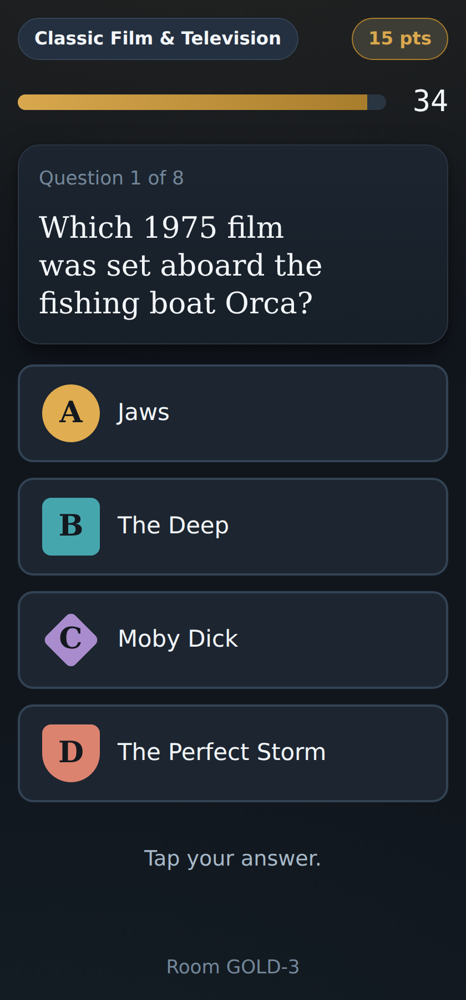
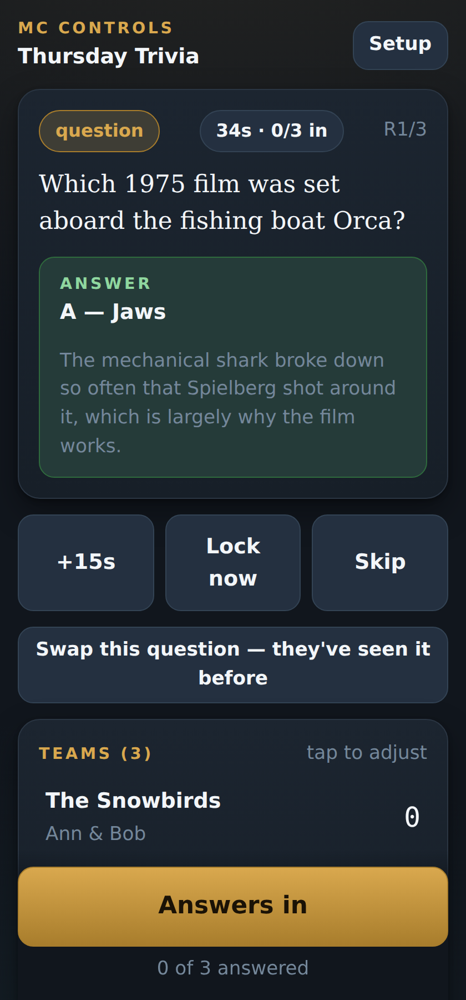
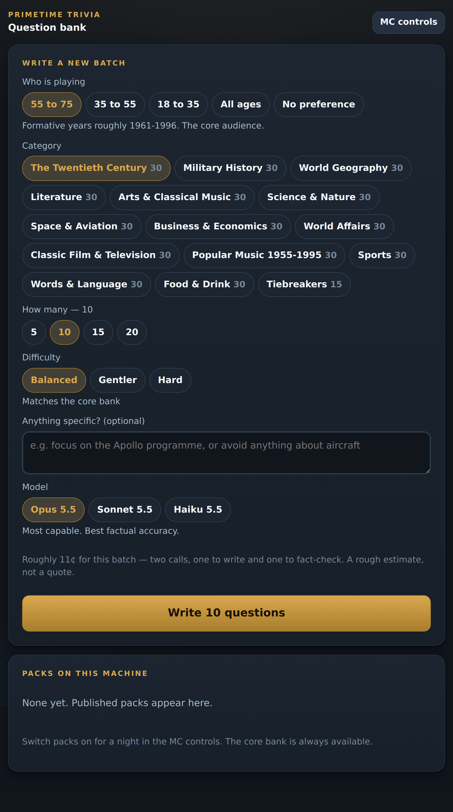

# PrimeTime Trivia

A trivia night host that runs on one laptop, over local wifi, with no internet.

Built for clubhouses, 55+ resorts and RV parks — specifically for players who are
sharp, well read and widely travelled, and who stop coming back if the questions
are easy.

```
     ┌──────────┐   HDMI    ┌─────────────┐
     │  laptop  │──────────▶│  TV / projector │   the big screen
     │          │           └─────────────┘
     │  server  │
     │  + 435   │   wifi    ┌─────────────┐
     │ questions│──────────▶│  MC's phone │   controls, answer key
     └──────────┘           └─────────────┘
           │        wifi    ┌─────────────┐
           └───────────────▶│ team tablets│   four big buttons
                            └─────────────┘
```

## What it looks like

The big screen, mid-question. Four options, each carrying a letter, a colour
and a distinct shape:


The reveal, where the evening actually happens — the answer, and something
worth saying about it:



A team's tablet and the MC's phone. The MC always has the answer and one
obvious next button:

| Player | MC |
|---|---|
|  |  |

Regenerate these any time with `npm run screenshots` — the script plays a real
game against a throwaway server, so it also catches UI regressions that unit
tests cannot see.

## Quick start

```bash
git clone https://github.com/gmdeckard/primetime-trivia.git
cd primetime-trivia
npm install
npm run build
npm start
```

The terminal prints everything you need:

```
  Trivia Night
  ────────────────────────────────────────────────────
  Players join at   http://192.168.1.42:8080
  Big screen        http://192.168.1.42:8080/host
  MC controls       http://192.168.1.42:8080/control
  Host PIN          297392
  Room code         CORAL-9
  ────────────────────────────────────────────────────
  435 questions in 15 categories
```

Open `/host` on the screen the room can see, open `/control` on your phone and
enter the PIN, and tell everyone else the join address. The host screen shows a
QR code, which is how most people will actually join.

## The three screens

**The big screen** (`/host`) is read-only and sized for a projector at the far
end of a room. It shows the question, the four options, the timer, how many
teams have answered, and then the answer with something interesting to say
about it. It never shows the answer key early.

**The MC's phone** (`/control`) has one large primary button pinned to the
bottom that always does the obvious next thing, plus the answer and a peek at
the next question. The point of separating this from the host screen is that
the MC can run the room while facing it, instead of hunched over the laptop.
Space bar also advances, so a bluetooth clicker works.

**The team tablets** (`/`) show one decision at a time. Four big buttons,
each with a letter, a colour and a distinct shape. Either partner can change
the team's answer until the lock, and the screen names whoever last tapped it —
which settles the "did you lock it in?" conversation that otherwise happens at
every table.

## Network setup

The laptop and the tablets need to be on the same network. They do **not** need
internet.

**Recommended: bring your own travel router.** A $30 GL.iNet or similar gives
you a fixed SSID and lets you reserve a static IP for the laptop, which means
the join address never changes and you can print the QR code on table cards
once. It also sidesteps the real hazard of venue wifi: many guest networks
enable **client isolation**, which silently blocks devices from reaching each
other and breaks everything with no useful error.

**Using the clubhouse wifi** works too. The server detects its address at boot
and the host screen displays it. If players can reach the page but nothing
loads, client isolation is the first thing to suspect.

Set `PRIMETIME_SSID` and the host screen will tell people which network to join
before giving them the address:

```bash
PRIMETIME_SSID="Clubhouse-Guest" PRIMETIME_VENUE="Thursday Trivia" npm start
```

## Running a night

The structure is **Night → Block → Round → Question**.

A **block** is about thirty minutes: three rounds of eight questions plus a
Jeopardy-style final wager. When a block ends you can start another with the
same teams and carried-over scores, so a thirty-minute activity slot and a
two-hour evening are the same software.

The MC can adjust pacing live (seconds per question, speed bonus, read-aloud)
and fix things as they go: extend the clock, swap a question the room has
clearly seen, adjust a score, rename or remove a team. No question repeats
within a night, and by default none repeats within eight nights either — so a
weekly game does not recycle in a month.

Ties at the top are broken with a numeric sudden-death question where the
closest guess wins.

## Design decisions worth knowing

A few choices are deliberate and will look like omissions otherwise.

**Difficulty is weighted medium-hard.** The default round runs 2-2-3-3-4-3-3-4
on a four-point scale. For an audience with advanced degrees the failure mode
is condescension, not frustration. Distractors have to be genuinely plausible;
a question where three options are obviously wrong is worthless.

**The speed bonus goes only to the fastest correct team**, and is worth 5 points
against 10-30 for a correct answer. A sliding reaction-time scale sounds fairer
but turns every question into a reflex test, which measures eyesight rather
than knowledge. It can be switched off entirely.

**Type is large and answers are redundantly coded.** Body text starts at 19px,
tap targets are 84px tall, and every option carries a letter *and* a colour
*and* a shape. Presbyopia is universal past 55 and colour vision deficiency is
common; neither is a reason to simplify the questions.

**Nothing requires post-1995 knowledge.** Categories are weighted toward the
formative years of players born between about 1950 and 1970, with enough
general knowledge that it is not purely nostalgia.

## Configuration

Environment variables:

| Variable | Default | Meaning |
|---|---|---|
| `PORT` | `8080` | HTTP port |
| `PRIMETIME_VENUE` | `Trivia Night` | Event name on the big screen |
| `PRIMETIME_SSID` | — | Wifi network name, shown on the join screen |
| `PRIMETIME_PIN` | random 6 digits | Control-view PIN |
| `PRIMETIME_CONTENT` | `./content` | Question bank directory |
| `PRIMETIME_DATA` | `./data` | Saved game state and history |

Everything else — team size, block shape, timing, categories, speed bonus,
final wager, read-aloud — is set from the control view before you start.

Team size is selectable between **2** (couples, the common case) and **4**
(tables). It caps how many people can sit on one team; a team can always share
a single tablet regardless.

## The question bank

435 questions across 15 categories, as YAML in `content/`. That is enough for
roughly eighteen thirty-minute blocks with no repeats — a good season, but not
the "thousands" a venue running weekly for years will eventually want. The
bank is designed to grow by pull request, and `content/` is the easiest place
to contribute.

```yaml
category: military-history
questions:
  - id: mil-001
    difficulty: 2
    prompt: Operation Husky was the Allied invasion of which island in July 1943?
    answer: Sicily
    distractors: [Sardinia, Crete, Corsica]
    fact: Mussolini was deposed within two weeks of the landings, on 25 July 1943.
    era: 1940s
    tags: [wwii, mediterranean]
```

Note there is no answer *index*. You write the answer and three distractors,
and the server shuffles them every time the question is asked — so the right
answer is never in the same slot twice, and a contributor cannot introduce a
silent off-by-one error.

```bash
npm run validate      # check every question, and that nothing is misquoted
npm run fix:content   # repair YAML quoting automatically
npm run stats         # category and difficulty breakdown
```

See [docs/QUESTION-STYLE.md](docs/QUESTION-STYLE.md) for what makes a good
question for this audience, and [CONTRIBUTING.md](CONTRIBUTING.md) for the
mechanics.

## Writing new questions with the Claude API

The `/author` screen generates question packs, fact-checks them with a second
independent call, and puts them in front of you for review.



**Generated questions are drafts until a person approves them.** Anything the
fact-check marks suspect or wrong arrives already rejected, so a distracted
reviewer produces a smaller pack rather than a wrong answer on the big screen.
There is a test asserting nothing unapproved can reach a pack file.

Generation needs internet and `ANTHROPIC_API_KEY`. **The game needs neither** —
write packs at home, play them offline. Approved questions land in
`content/packs/` as ordinary content files, and the MC switches packs on per
night in the controls.

See [docs/AUTHORING.md](docs/AUTHORING.md).

## Development

```bash
npm run dev       # server on 8080, client with hot reload on 5173
npm test          # content validation, engine tests, integration tests
npm run build     # production bundles
```

Stack: Node and TypeScript on the server, Preact on the client, YAML for
content, websockets for everything live. **No native dependencies and no
database** — `npm install` works on any laptop without build tools, which
matters when the machine is a clubhouse Dell that nobody wants to set up
twice. The whole player bundle is about 14 kB gzipped.

See [docs/ARCHITECTURE.md](docs/ARCHITECTURE.md) for how it fits together and
why.

## License

MIT. See [LICENSE](LICENSE).

Question content is contributed under the same license; see
[docs/QUESTION-STYLE.md](docs/QUESTION-STYLE.md) on provenance. Please don't
paste questions from commercial quiz books or trivia apps.
