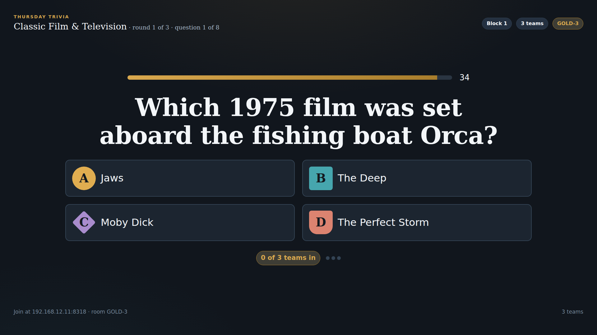
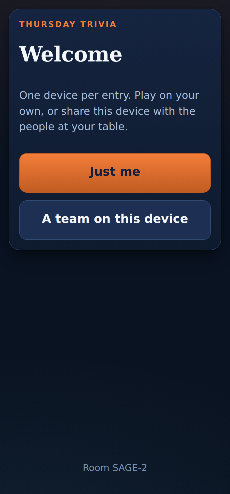
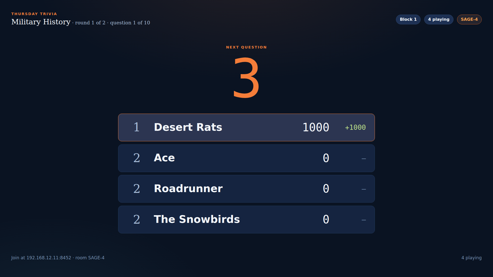

# PrimeTime Trivia

A trivia night host that runs on one laptop, over local wifi, with no internet.

Built for clubhouses, 55+ resorts and RV parks — specifically for players who are
sharp, well read and widely travelled, and who stop coming back if the questions
are easy.

```
     ┌──────────┐   HDMI    ┌─────────────┐
     │  laptop  │──────────▶│  TV / projector │   the big screen
     │          │           └─────────────┘
     │  server  │
     │  + 435   │   wifi    ┌─────────────┐
     │ questions│──────────▶│  MC's phone │   controls, answer key
     └──────────┘           └─────────────┘
           │        wifi    ┌─────────────┐
           └───────────────▶│ team tablets│   four big buttons
                            └─────────────┘
```

## What it looks like

The big screen, mid-question. Four options, each carrying a letter, a colour
and a distinct shape:



One device is one entry — solo or a table sharing a tablet:



Live standings sit beside the question all round, with a filled dot for each
team that has locked an answer — so the room can see the race without waiting
for the end of the round.

The reveal, where the evening actually happens — the answer, and something
worth saying about it:


Then the last few seconds of the gap belong to the scoreboard, so every
question ends on where everyone stands:



A team's tablet and the MC's phone. The MC always has the answer and one
obvious next button:

| Player | MC |
|---|---|
|  |  |

Regenerate these any time with `npm run screenshots` — the script plays a real
game against a throwaway server, so it also catches UI regressions that unit
tests cannot see.

## Requirements

**Node.js 20 or newer.** That is the only prerequisite — there are no native
dependencies, no database, and no build toolchain needed.

Ubuntu and Debian ship a version of Node too old to run this, so install a
current one first:

```bash
curl -fsSL https://deb.nodesource.com/setup_22.x | sudo -E bash -
sudo apt-get install -y nodejs
node -v          # expect v22.x
```

On macOS: `brew install node`. On Windows, use the installer from nodejs.org.

## Quick start

```bash
git clone https://github.com/gmdeckard/primetime-trivia.git
cd primetime-trivia
npm install
npm run build
npm start
```

Or use the wrappers, which work the same whether or not the boot service is
installed:

```bash
./start-server.sh
./stop-server.sh
```

The terminal prints everything you need:

```
  PrimeTime Trivia
  ────────────────────────────────────────────────────
  Players join at   http://192.168.1.42:8080
  Big screen        http://192.168.1.42:8080/host
  MC controls       http://192.168.1.42:8080/control
  Question editor   http://192.168.1.42:8080/author
  Host password     brass-lantern-42
  Room code         CORAL-9
  ────────────────────────────────────────────────────
  435 questions in 15 categories
```

Open `/host` on the screen the room can see, open `/control` on your phone and
enter the host password, and tell everyone else the join address. The host
screen shows a QR code, which is how most people will actually join.

The password is set on the server and does not change between games, so the MC
types it once per phone rather than once per night. Set it with
`PRIMETIME_PASSWORD`, or write it into `data/control-password` — the first
non-empty line of that file is the password, and lines starting with `#` are
comments. If neither is set, the server generates one on first start and saves
it to that file, so it is still the same next time. Edit the file and restart
to change it; that signs every device out.

## The three screens

**The big screen** (`/host`) is read-only and sized for a projector at the far
end of a room. It shows the question, the four options, the timer, how many
teams have answered, and then the answer with something interesting to say
about it. It never shows the answer key early.

**The MC's phone** (`/control`) has one large primary button pinned to the
bottom that always does the obvious next thing, plus the answer and a peek at
the next question. Inside a round the game advances itself — lock, reveal,
next — so the MC can work the room instead of the laptop, with a **Pause**
button for when they want to talk. Breaks run on a clock too, and a switch
decides whether reaching zero starts the next round or waits for the MC, so
the night can run itself end to end or stop at every boundary. The point of
separating this from the host screen is that the MC can run the room while
facing it, instead of hunched over the laptop.
Space bar also advances, so a bluetooth clicker works.

**The players' devices** (`/`) show one decision at a time. Four big buttons,
each with a letter, a colour and a distinct shape.

**One device is one entry.** On joining, you say whether you're playing on your
own or as a table sharing the device, then pick a handle — it doesn't have to
be your real name. There's no joining someone else's team and no list to find
your partner in, which is the only model that survives a hundred people
arriving at once.

## Network setup

The laptop and the tablets need to be on the same network. They do **not** need
internet.

**Recommended: bring your own travel router.** A $30 GL.iNet or similar gives
you a fixed SSID and lets you reserve a static IP for the laptop, which means
the join address never changes and you can print the QR code on table cards
once. It also sidesteps the real hazard of venue wifi: many guest networks
enable **client isolation**, which silently blocks devices from reaching each
other and breaks everything with no useful error.

**Using the clubhouse wifi** works too. The server detects its address at boot
and the host screen displays it. If players can reach the page but nothing
loads, client isolation is the first thing to suspect.

The box can also **be** the wifi rather than join it, which is the answer when
the venue has nothing usable:

```bash
sudo ./scripts/network-mode.sh ap
```

To leave it running permanently on a Raspberry Pi, Jetson or mini PC — starting
on boot, restarting if it crashes, serving on port 80 so the join address has no
`:8080` on the end — see [docs/DEPLOYMENT.md](docs/DEPLOYMENT.md).

Set `PRIMETIME_SSID` and the host screen will tell people which network to join
before giving them the address:

```bash
PRIMETIME_SSID="Clubhouse-Guest" PRIMETIME_VENUE="Thursday Trivia" npm start
```

## Running a night

The structure is **Night → Game → Round → Question**, which are the words the
MC says out loud.

A **round** is ten questions. A **game** is a couple of rounds closed by a
Jeopardy-style final wager, about forty minutes with its break. A **night** is
however many games you set, and it ends itself after the last one. Scores
carry across games, so a thirty-minute activity slot and a two-hour evening
are the same software.

Five minutes between rounds, ten between games, both configurable and both
counted down on every screen. By default a round draws **one question from
each of ten shuffled categories**, so nobody sits out a round because they
know nothing about opera; a themed round on a single category is a switch
away.

The MC can adjust pacing live and fix things as they go: extend the clock,
swap a question the room has clearly seen, adjust a score, rename or remove a
team. **No question comes back until the bank has been used up** — each age
group has its own deck per category, only reshuffled when it runs out, and
that survives restarts, new nights and Reset everything.

Ties at the top are broken with a numeric sudden-death question where the
closest guess wins.

## Design decisions worth knowing

A few choices are deliberate and will look like omissions otherwise.

**Difficulty is weighted medium-hard.** The default round runs 2-2-3-3-4-3-3-4
on a four-point scale. For an audience with advanced degrees the failure mode
is condescension, not frustration. Distractors have to be genuinely plausible;
a question where three options are obviously wrong is worthless.

**Scoring is Buzztime-style.** Every question is worth 1000 points, holds full
value for the first five seconds while the room reads, then slides to 200 at
the buzzer. Difficulty does not change the value; what separates two teams who
both knew the answer is how fast they were sure. At twenty to thirty points a
question the board filled with ties. The floor sits well above zero on
purpose: a correct answer arrived at slowly is still a correct answer, and a
game that pays nothing for one stops being worth playing by the third round.
All three numbers are settings.

**Type is large and answers are redundantly coded.** Body text starts at 19px,
tap targets are 84px tall, and every option carries a letter *and* a colour
*and* a shape. Presbyopia is universal past 55 and colour vision deficiency is
common; neither is a reason to simplify the questions.

**Nothing requires post-1995 knowledge.** Categories are weighted toward the
formative years of players born between about 1950 and 1970, with enough
general knowledge that it is not purely nostalgia.

## Running it on Windows

The server runs anywhere Node 20 does, including the laptop that drives the TV.
`.\start-server.ps1` is the Windows equivalent of `./start-server.sh`.

Running server and big screen on the same machine has one advantage worth
knowing: the browser's wake lock only works in a secure context, which
`http://localhost` is and a LAN address is not. Open the host screen at
`http://localhost:8080/host` and it keeps the screen awake by itself.

The firewall is the thing that stops a night — Windows blocks inbound Node by
default, and blocks nearly everything on a network classified Public. See
[docs/DEPLOYMENT.md](docs/DEPLOYMENT.md) for the one-line rule and the rest.

## Configuration

Environment variables:

| Variable | Default | Meaning |
|---|---|---|
| `PORT` | `8080` | HTTP port |
| `PRIMETIME_VENUE` | `Trivia Night` | Event name on the big screen |
| `PRIMETIME_SSID` | — | Wifi network name, shown on the join screen |
| `PRIMETIME_PASSWORD` | generated once, saved to `data/control-password` | Password for `/control` and `/author` |
| `PRIMETIME_PIN` | — | Deprecated name for the above; still honoured |
| `PRIMETIME_HOST_IP` | auto-detected | Pin the address shown on the join screen; skips the startup prompt |
| `PRIMETIME_NO_PICK` | — | Set to skip the startup address prompt and take the automatic pick |
| `PRIMETIME_CONTENT` | `./content` | Question bank directory |
| `PRIMETIME_DATA` | `./data` | Saved game state and history |

Everything else — the shape of the night, timing, breaks, scoring, categories,
final wager, sound, read-aloud — is set from the control view.

Players choose for themselves whether they're solo or a table sharing one
device. Nothing caps the room — it's been load-tested at 100 simultaneous
entries.

## The question bank

1919 questions as YAML in `content/questions/`, one folder per age group, a
folder per question set inside that, and one file per category inside that:

```
content/questions/35-75/adult1/geography.yaml  the adult room, 824 questions
content/questions/35-75/adult2/geography.yaml  a second adult pack, 1000
content/questions/8-12/kids1/…                 80
content/questions/shared/tiebreakers.yaml      in play on every night
```

**The outer folder is the age group.** Picking one in Setup swaps the night's
material wholesale, and the MC's screen lists the groups the bank actually
holds something for, with live counts — adding `content/questions/18-35/` is
all it takes to add a group. **The folder inside it is a question set**, which
the MC switches on and off for the night; every multiple-choice question
belongs to one, and only the tiebreakers sit outside them.

At two rounds of ten a game, the adult bank is about twenty-seven full nights with
no repeats, which is most of a year of weekly play. The kids' bank is one
night and a bit, and is the part that needs writing next. `npm run validate` prints what each age group can
support. The bank is designed to grow by pull request, and `content/` is the
easiest place to contribute.

```yaml
category: military-history
questions:
  - id: mil-001
    difficulty: 2
    prompt: Operation Husky was the Allied invasion of which island in July 1943?
    answer: Sicily
    distractors: [Sardinia, Crete, Corsica]
    fact: Mussolini was deposed within two weeks of the landings, on 25 July 1943.
    era: 1940s
    tags: [wwii, mediterranean]
```

Note there is no answer *index*. You write the answer and three distractors,
and the server shuffles them every time the question is asked — so the right
answer is never in the same slot twice, and a contributor cannot introduce a
silent off-by-one error.

```bash
npm run validate      # check every question, and that nothing is misquoted
npm run fix:content   # repair YAML quoting automatically
npm run stats         # category and difficulty breakdown
```

See [docs/QUESTION-STYLE.md](docs/QUESTION-STYLE.md) for what makes a good
question for this audience, and [CONTRIBUTING.md](CONTRIBUTING.md) for the
mechanics.

## Writing new questions with the Claude API

The `/author` screen generates question packs, fact-checks them with a second
independent call, and puts them in front of you for review.


**Generated questions are drafts until a person approves them.** Anything the
fact-check marks suspect or wrong arrives already rejected, so a distracted
reviewer produces a smaller pack rather than a wrong answer on the big screen.
There is a test asserting nothing unapproved can reach a pack file.

Generation needs internet and `ANTHROPIC_API_KEY`. **The game needs neither** —
write packs at home, play them offline. Approved questions land in
`content/packs/` as ordinary content files, and the MC switches packs on per
night in the controls.

See [docs/AUTHORING.md](docs/AUTHORING.md).

## Development

```bash
npm run dev       # server on 8080, client with hot reload on 5173
npm test          # content validation, engine tests, integration tests
npm run flow      # play a whole night in a browser, with nobody touching it
npm run jitter    # fail if any live clock changes size as it counts down
npm run beds      # render the big screen's question music to mp3, in docs/beds
npm run build     # production bundles
```

Stack: Node and TypeScript on the server, Preact on the client, YAML for
content, websockets for everything live. **No native dependencies and no
database** — `npm install` works on any laptop without build tools, which
matters when the machine is a clubhouse Dell that nobody wants to set up
twice. The whole player bundle is about 14 kB gzipped.

See [docs/ARCHITECTURE.md](docs/ARCHITECTURE.md) for how it fits together and
why.

## License

MIT. See [LICENSE](LICENSE).

Question content is contributed under the same license; see
[docs/QUESTION-STYLE.md](docs/QUESTION-STYLE.md) on provenance. Please don't
paste questions from commercial quiz books or trivia apps.
